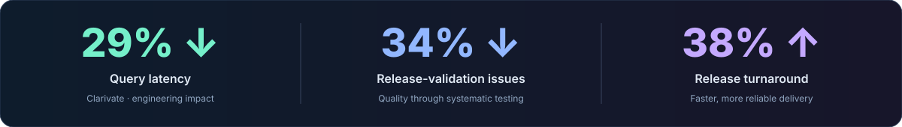
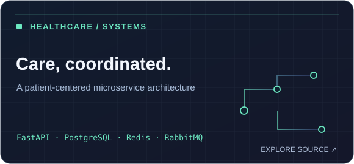
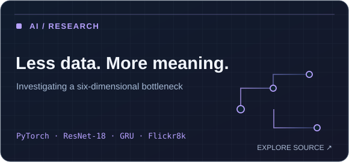
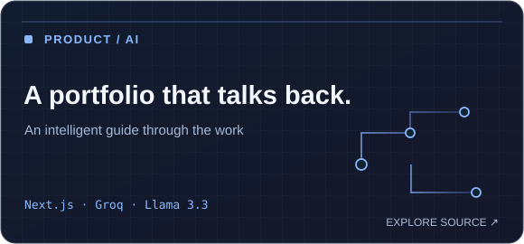
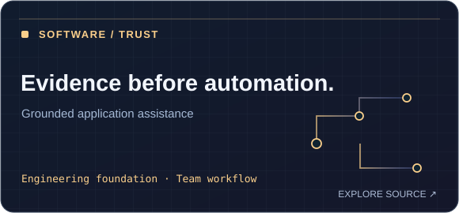

<div align="center">
  
  <br />
  <strong>Graduate Research Assistant @ Texas A&amp;M University–Corpus Christi</strong> &nbsp;·&nbsp; Former Software Engineer @ Clarivate
  <br /><br />
  <a href="mailto:nithinthirumani0553@gmail.com"></a>
  <a href="https://github.com/Nithin0553?tab=repositories"></a>
  <a href="https://github.com/Nithin0553/Nithin-Portfolio"></a>
</div>

---

### Hello — I'm Nithin. 👋

I’m a **software engineer who thinks like a researcher** and a **researcher who cares about the software that makes ideas useful**.

My work sits where **AI, large language models, deep learning, and backend systems** meet. At Texas A&M University–Corpus Christi, I explore AI/LLM workflows, experimental evaluation, and intelligent automation. Before graduate school, I built and improved software at **Clarivate**, with a focus on backend performance, quality, and dependable releases.

I enjoy going beyond a working demo: understanding why something works, measuring it, and turning it into something another person can actually use.

> **My engineering philosophy:** Start with a question. Build the smallest convincing system. Measure what matters. Improve until it is dependable.

<p align="center">
  <a href="#the-impact"><strong>01 · Impact</strong></a> &nbsp;→&nbsp;
  <a href="#the-work"><strong>02 · Selected work</strong></a> &nbsp;→&nbsp;
  <a href="#the-thinking"><strong>03 · How I think</strong></a> &nbsp;→&nbsp;
  <a href="#the-toolkit"><strong>04 · Toolkit</strong></a> &nbsp;→&nbsp;
  <a href="#lets-connect"><strong>05 · Connect</strong></a>
</p>

<a id="the-impact"></a>
## 01 / Engineering with measurable outcomes

The best kind of engineering story has evidence behind it. At **Clarivate** (Software Engineer · May 2022–Jun 2024), my work contributed to the following improvements:



Those numbers represent the work I enjoy most: investigating bottlenecks, improving application behavior, strengthening validation, and making releases less painful.

<a id="the-work"></a>
## 02 / A few things I've been building

*Not just a list of repositories — a cross-section of the problems I like solving.* Select a card to explore the source.

<table>
  <tr>
    <td width="50%" valign="top">
      <a href="https://github.com/Nithin0553/Health-Care-Management-System"></a>
      <sub><strong>BACKEND / DISTRIBUTED SYSTEMS</strong> · Patient management, appointments, permissions, caching, and asynchronous notifications.</sub>
    </td>
    <td width="50%" valign="top">
      <a href="https://github.com/Nithin0553/minimalist-image-captioning"></a>
      <sub><strong>RESEARCH / COMPUTER VISION</strong> · Exploring how much semantic information survives a deliberately tiny 6-D representation.</sub>
    </td>
  </tr>
  <tr>
    <td width="50%" valign="top">
      <a href="https://github.com/Nithin0553/Nithin-Portfolio"></a>
      <sub><strong>FULL STACK / GENERATIVE AI</strong> · A portfolio with an AI companion, guided navigation, and a conversational interface.</sub>
    </td>
    <td width="50%" valign="top">
      <a href="https://github.com/Nithin0553/ApplyWise"></a>
      <sub><strong>TEAM SOFTWARE ENGINEERING / IN PROGRESS</strong> · Building a trustworthy foundation for evidence-grounded resume tailoring and application workflows.</sub>
    </td>
  </tr>
</table>

**In my private workshop:** **Jarvis**, a personal AI-assistant project exploring intelligent interaction and automation. I’m also developing a **personal-finance app** focused on clearer spending decisions and useful financial insights. Both are evolving builds rather than public production releases.

<a id="the-thinking"></a>
## 03 / The thinking behind the code

GitHub READMEs are usually static. This section isn't. **Open a path based on what you're looking for.**

<details>
<summary><strong>🧠 I'm hiring for applied AI / ML — what does Nithin bring?</strong></summary>
<br />

- **Research mindset:** I work on AI, LLMs, deep learning, model evaluation, and intelligent automation as a Graduate Research Assistant at **Texas A&M University–Corpus Christi** (Apr 2025–present).
- **Experiment design:** I care about meaningful baselines, reproducible pipelines, error analysis, and limitations — not just a compelling prediction.
- **Hands-on example:** [Minimalist 6-D Image Captioning](https://github.com/Nithin0553/minimalist-image-captioning) couples a frozen ResNet-18 encoder with a constrained GRU decoder, then evaluates caption quality and noise sensitivity.
- **Where I'm heading:** Practical LLM systems that are useful, testable, and thoughtfully integrated into applications.

</details>

<details>
<summary><strong>⚙️ I'm hiring for backend / software engineering — what does Nithin bring?</strong></summary>
<br />

- **Production experience:** Software Engineer at **Clarivate** (May 2022–Jun 2024), improving performance, validation, and release processes.
- **Architecture:** API design, REST services, databases, microservices, caches, asynchronous processing, and container workflows.
- **Hands-on example:** [Healthcare Management System](https://github.com/Nithin0553/Health-Care-Management-System) models multi-service interactions using FastAPI, PostgreSQL, Redis, and RabbitMQ.
- **What I optimize for:** Readable systems, predictable behavior, useful tests, and calm, repeatable delivery.

</details>

<details>
<summary><strong>✨ I'm curious how Nithin approaches a new problem</strong></summary>
<br />

```text
A problem worth solving
       │
       ▼
Understand the constraints
       │
       ▼
Prototype → instrument → evaluate
       │
       ▼
Improve the system, not just the demo
       │
       ▼
Document → test → share what I learned
```

I enjoy projects that force me to move between **research, product thinking, and engineering detail**. Strong solutions tend to emerge when those perspectives challenge each other.

</details>

### A little about the journey

| Chapter | What it taught me |
| :-- | :-- |
| **M.S. Computer Science** · Texas A&M University–Corpus Christi · 2025–2026 | Research methods, advanced computing, and a deeper foundation for AI systems. |
| **Graduate Research Assistant** · Apr 2025–present | Asking better questions about AI, designing experiments, and evaluating intelligent workflows. |
| **Software Engineer — Clarivate** · May 2022–Jun 2024 | Performance, debugging, maintainability, delivery discipline, and engineering with measurable results. |

<a id="the-toolkit"></a>
## 04 / The toolkit

**Languages** &nbsp; `Python` `Java` `JavaScript` `TypeScript` `SQL`

**AI / research** &nbsp; `PyTorch` `TensorFlow` `Hugging Face` `LLMs` `RAG` `LangChain` `LangGraph` `Deep Learning`

**Backend / data** &nbsp; `FastAPI` `REST APIs` `Pydantic` `PostgreSQL` `MySQL` `Redis` `RabbitMQ`

**Cloud / delivery** &nbsp; `AWS` `Azure` `Docker` `Kubernetes` `Terraform` `GitHub Actions` `CI/CD` `Pytest`

*I value choosing the right tool for a problem more than collecting tools for a list.*

<a id="lets-connect"></a>
## 05 / Let's build something that matters

I'm interested in **software engineering, applied AI, AI/ML engineering, and intelligent backend systems** — especially teams that value curiosity, clear thinking, and engineering rigor.

**Have a role, an interesting research question, or an ambitious system to build?** I'd love to hear about it.

<p align="center">
<a href="mailto:nithinthirumani0553@gmail.com"><strong>✉️ Start a conversation</strong></a>
&nbsp; · &nbsp;
<a href="https://github.com/Nithin0553?tab=repositories"><strong>↗ Explore repositories</strong></a>
&nbsp; · &nbsp;
<a href="https://github.com/Nithin0553/Nithin-Portfolio"><strong>◈ Interactive portfolio source</strong></a>
</p>

<p align="center"><sub>Designed like my work: considered, curious, and always evolving. · Nithin Thirumani</sub></p>
